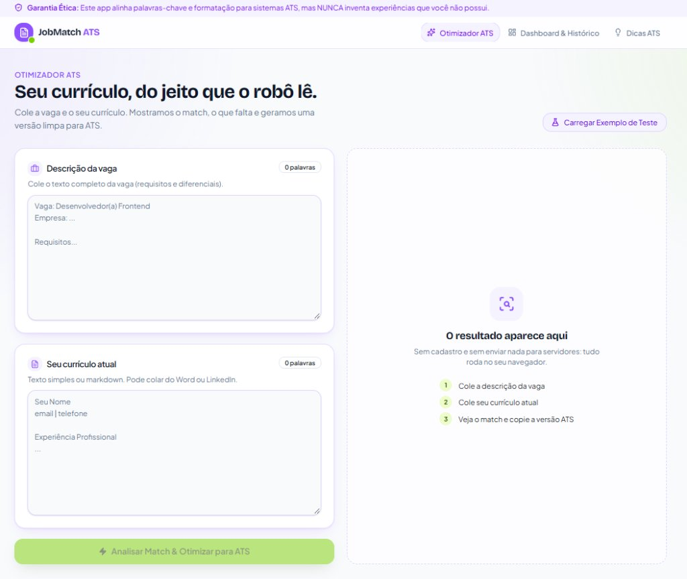
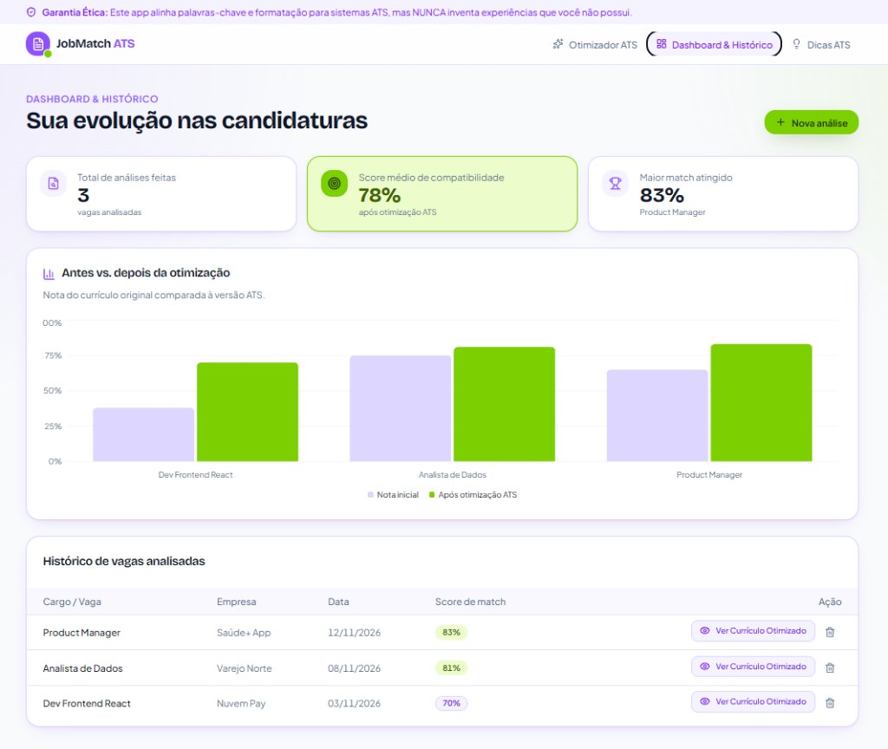
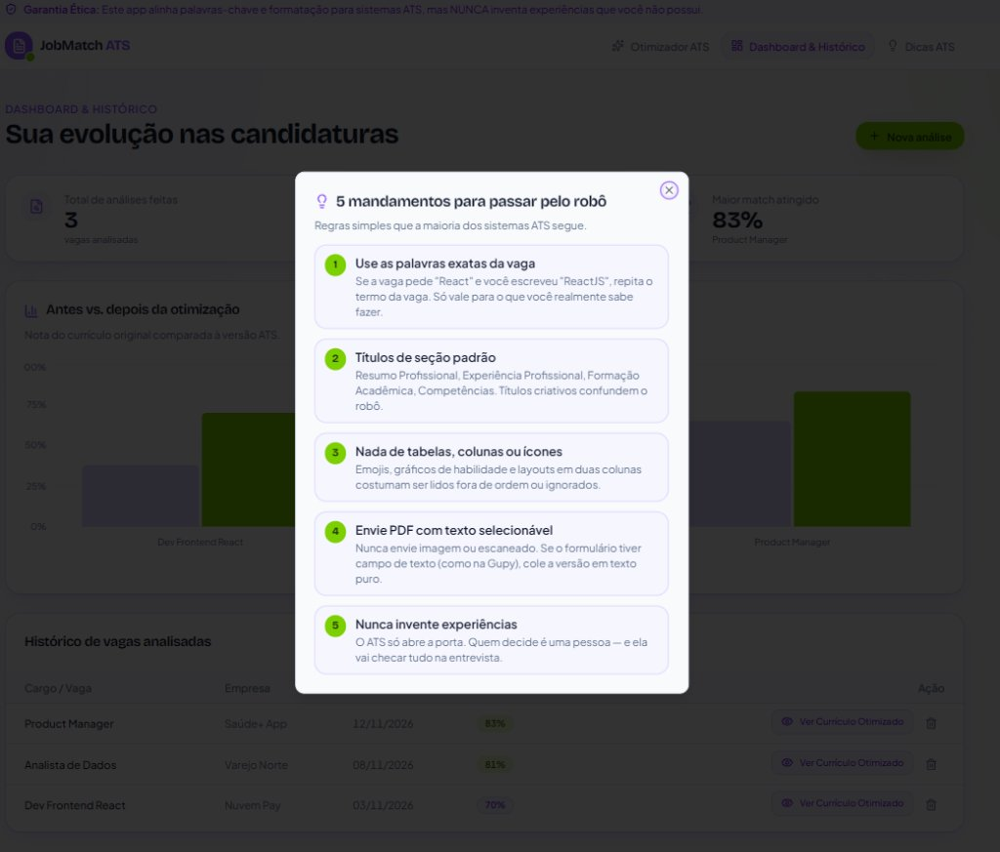

# 📄 JobMatch ATS — Otimizador de Currículos & Matchmaking para Robôs ATS

<p align="center">
  
  
  
  
  
  
  
</p>

> Projeto desenvolvido para o desafio prático do **Bootcamp Santander: Construa seu Primeiro App com I.A.** na plataforma **DIO (Digital Innovation One)**, aplicando Inteligência Artificial como parceira de desenvolvimento desde a engenharia de prompts até a publicação do produto no ar.

---

## 🌐 Demonstração Online & Repositório

- **Aplicação no Ar (Deploy):** [https://curriculo-ats-jobmatch.lovable.app/](https://curriculo-ats-jobmatch.lovable.app/)
- **Repositório no GitHub:** [https://github.com/V1ctorG0mes/dio-lab-app-curriculo-ats-jobmatch](https://github.com/V1ctorG0mes/dio-lab-app-curriculo-ats-jobmatch)

---

## 📸 Telas da Aplicação

<div align="center">
  <h3>1. Otimizador ATS & Diagnóstico de Match</h3>
  

  <br/><br/>
  <h3>2. Dashboard de Métricas & Histórico com Gráficos Recharts</h3>
  

  <br/><br/>
  <h3>3. Os 5 Mandamentos para Passar pelo Robô ATS</h3>
  
</div>

---

## 🎯 1. A Dor Escolhida e Por Que Vale um Negócio

### O Problema
Milhões de profissionais altamente capacitados se candidatam diariamente a vagas de emprego, mas **seus currículos são descartados nos primeiros 5 segundos por robôs de triagem (ATS — *Applicant Tracking Systems*)**, como Gupy, Workday, Taleo e Greenhouse, antes mesmo de qualquer recrutador humano abrir o documento.

Os principais motivos de rejeição algorítmica são:
1. **Desalinhamento de Vocabulário:** A vaga pede *"React"* e o candidato escreveu *"ReactJS"*; a vaga pede *"Scrum"* e o candidato escreveu *"Métodos Ágeis"*. O robô não pontua o termo e diminui o ranking do candidato.
2. **Formatação Incompatível:** Tabelas com múltiplas colunas, gráficos de barra de habilidades, caixas de texto e ícones decorativos embaralham o parser de leitura óptica dos ATS.
3. **Falta de Clareza em Resultados:** Experiências descritas de forma genérica sem verbos de ação e métricas tangíveis de impacto.

### A Oportunidade
Construir uma ferramenta web **ágil, 100% gratuita, sem necessidade de cadastro ou atrito**, que analisa a aderência entre a vaga e o currículo, diagnostica termos ausentes e formata uma versão limpa e legível para qualquer robô de RH.

---

## 🛡️ 2. O Princípio Ético Inegociável (A Regra de Ouro)

> *"Garantia Ética: Este app alinha palavras-chave e formatação para sistemas ATS, mas **NUNCA inventa experiências que você não possui**."*

Seguindo a diretriz pedagógica do Expert Bruno na DIO, a ferramenta:
- **Não alucina competências:** Ela nunca cria cargos fictícios, empresas imaginárias ou cursos inexistentes.
- **Trabalha com equivalência semântica:** Mapeia termos técnicos (léxico com suporte a sinônimos e variações de grafia) e reorganiza o conteúdo já fornecido pelo candidato para evidenciar seus pontos fortes.
- **Foco na transparência:** A seção de palavras-chave faltantes atua como um guia de autoavaliação sincero sobre o que a vaga exige e o que o candidato de fato sabe.

---

## 📊 3. Tamanho de Mercado e Business Model Canvas

### Estimativa de Mercado (TAM, SAM, SOM)
- **TAM (Total Addressable Market):** Mais de **100 milhões de profissionais economicamente ativos** no Brasil participando de seleções corporativas.
- **SAM (Serviceable Addressable Market):** Aproximadamente **8 milhões de profissionais de tecnologia, produtos digitais, finanças e serviços corporativos** cujos processos seletivos são mediados por softwares ATS.
- **SOM (Serviceable Obtainable Market):** **120.000 profissionais em busca ativa de recolocação ou transição de carreira** que buscam ferramentas rápidas de otimização de currículo sem pagar assinaturas mensais caras.

### Business Model Canvas (Resumo Executivo)
| Bloco do Canvas | Descrição no Negócio |
| :--- | :--- |
| **Proposta de Valor** | Matchmaking instantâneo de currículos com vagas e geração de versão 100% legível por ATS em menos de 1 minuto, com garantia ética de veracidade. |
| **Segmento de Clientes** | Desenvolvedores, analistas de dados, gerentes de produto e profissionais em transição de carreira. |
| **Canais** | Aplicação Web responsiva (SPA), compartilhamento orgânico em comunidades tech (LinkedIn, GitHub, Discord). |
| **Relacionamento** | Experiência self-service instantânea, sem fricção de login obrigatório, com salvamento transparente no navegador (`localStorage`). |
| **Fontes de Receita (Roadmap)** | Versão Core 100% gratuita; expansão futura para planos Pro com integração a portais de vagas e simulação de entrevistas com IA. |
| **Recursos Chave** | Algoritmo Léxico ATS client-side, componentes acessíveis shadcn/ui, dashboard analítico com Recharts. |
| **Atividades Chave** | Curadoria contínua do dicionário de palavras-chave técnicas, refinamento de templates ATS e testes de compatibilidade. |
| **Parcerias Chave** | Lovable (desenvolvimento ágil assistido por IA) e DIO (ecossistema de educação tech). |
| **Estrutura de Custos** | Custo operacional zero no MVP (deploy estático em Cloudflare/Lovable e processamento local no cliente). |

---

## 🖥️ 4. O Fluxo da Aplicação

```
  [Colar Vaga]       +    [Colar Currículo]
       │                         │
       └───────────┬─────────────┘
                   ▼
       [Extração de Keywords & Léxico]
                   ▼
     ┌─────────────────────────────┐
     │  Diagnóstico & Match Score  │
     │  - Score (%) em Verde Lima  │
     │  - Keywords Encontradas     │
     │  - Keywords Faltantes       │
     └─────────────┬───────────────┘
                   ▼
   ┌────────────────────────────────┐
   │ Geração da Versão Otimizada    │
   │ - Estrutura Padrão ATS         │
   │ - Verbos de Ação + Impacto     │
   │ - Aba de Texto Puro (Gupy)     │
   └───────────────┬────────────────┘
                   ▼
     [Copiar]  │  [Salvar PDF]  │  [Dashboard de Histórico]
```

1. **Entrada de Dados Ágil:** Cards para colar a descrição da vaga e o currículo atual, com botão de **"Carregar Exemplo de Teste"** para experimentação com 1 clique (presets de Frontend, Dados e Product Management).
2. **Motor Léxico ATS:** O algoritmo extrai termos técnicos, hard skills, metodologias e certificações, comparando-os com o currículo por meio de expressões regulares seguras e normalização de caracteres (sem acentos e minúsculas).
3. **Diagnóstico Visual:** Círculo de progresso animado com o Match Score, badges em verde lima para termos validados e badges roxos para palavras ausentes.
4. **Currículo ATS Formatado:**
   - **Modo Folha A4:** Tipografia limpa, hierarquia linear (sem colunas), cabeçalho executivo e tópicos objetivos.
   - **Modo Texto Puro:** Formatado para copiar e colar diretamente em caixas de texto de portais de recrutamento.
5. **Exportação Sem Dependências Pesadas:** Botão de cópia rápida com Toast de confirmação e botão de impressão estilizado via regras CSS `@media print` para salvar em PDF perfeito.
6. **Dashboard com Gráficos & Histórico:** Página dedicada (`/dashboard`) com KPIs de evolução, tabela de histórico de candidaturas salvas no `localStorage` e gráfico de barras comparando **Nota Inicial vs. Nota Otimizada**.
7. **Modal "5 Mandamentos ATS":** Dicas práticas e didáticas para candidatos nunca caírem em armadilhas de formatação.

---

## 🤖 5. Engenharia de Prompts (Lovable)

O projeto foi gerado com sucesso utilizando o **Mega Prompt Único** estruturado em Markdown, garantindo arquitetura robusta, design system shadcn/ui e paleta de cores consistente:

```markdown
Crie uma aplicação web SPA completa, moderna e responsiva chamada JobMatch ATS, 
utilizando React, React Router, Tailwind CSS e componentes do shadcn/ui.

A aplicação serve para comparar currículos com vagas de emprego, gerar versões 
amigáveis para robôs ATS (Application Tracking Systems) e acompanhar métricas em um Dashboard.

1. Identidade Visual & Design System:
- Design System: Componentes shadcn/ui (Button, Card, Badge, Tabs, Progress, Dialog, Table, Alert, Tooltip).
- Cores: Fundo Branco (#FFFFFF), Primária Roxo Claro (#8B5CF6 / violet-500), Destaque Verde Lima (#84CC16 / lime-500).

2. Princípio Ético Obrigatório:
- "Garantia Ética: Este app alinha palavras-chave e formatação para sistemas ATS, mas NUNCA inventa experiências que você não possui."

3. Navegação Global:
- Header com rotas: "Otimizador ATS" (/), "Dashboard & Histórico" (/dashboard) e modal "Dicas ATS".

4. Página 1: Otimizador ATS (/):
- Entradas para Descrição da Vaga e Currículo com botão "Carregar Exemplo de Teste".
- Diagnóstico instantâneo: Score de Match (%), Palavras-Chave Encontradas vs. Faltantes.
- Visualizador do Currículo Otimizado em A4 e Texto Puro, com exportação e impressão limpa.

5. Página 2: Dashboard & Histórico (/dashboard):
- Cards de KPIs (Total de análises, Score médio, Maior match).
- Gráfico de barras comparando Nota Inicial vs. Nota Otimizada ATS (Recharts).
- Tabela de histórico persistida em localStorage.
```

---

## 🛠️ Tecnologias Utilizadas

- **[React 19](https://react.dev/):** Interface de usuário reativa com a versão mais recente do ecossistema React.
- **[TypeScript](https://www.typescriptlang.org/):** Tipagem estática rigorosa para garantir segurança e manutenibilidade.
- **[Tailwind CSS v4](https://tailwindcss.com/):** Estilização moderna e utilitária com alta performance.
- **[TanStack Router / TanStack Start](https://tanstack.com/router):** Roteamento tipado com renderização rápida e suporte a SSR/CSR.
- **[shadcn/ui](https://ui.shadcn.com/) / [Radix UI](https://www.radix-ui.com/):** Componentes de interface acessíveis, consistentes e customizáveis.
- **[Recharts](https://recharts.org/):** Visualização de dados e gráficos comparativos de evolução do candidato.
- **[Lucide React](https://lucide.dev/):** Ícones modernos e consistentes.
- **[Sonner](https://sonner.emilkowal.ski/):** Sistema de notificações e toasts visuais.
- **[Vitest](https://vitest.dev/):** Suíte de testes unitários para o motor léxico ATS e navegação.

---

## 🔒 Auditoria de Segurança & Privacidade

Antes da publicação, o código-fonte foi auditado e aprovado com base nas diretrizes do Bootcamp:
- ✅ **Zero Chaves de API Expostas:** O aplicativo não utiliza chaves de terceiros ou segredos no cliente.
- ✅ **Zero Dados Pessoais Sensíveis:** Todos os exemplos de teste utilizam nomes e contatos fictícios (*Marina Costa*, *Rafael Lima*, etc.).
- ✅ **Zero Custos Ocultos:** Toda a análise, histórico e cálculos operam 100% no navegador do usuário via JavaScript nativo e `localStorage`.

---

## 🧪 Suíte de Testes Unitários

O projeto possui cobertura de testes automatizados com **Vitest** validando o cálculo de score, extração de palavras-chave e garantia ética:

```bash
# Executar todos os testes
npm test
```

```text
 ✓ src/lib/ats.test.ts (7 tests)
   ✓ normalizes and extracts keywords from job description
   ✓ calculates match score correctly
   ✓ identifies missing keywords required by the vacancy
   ✓ maintains ethical integrity without hallucinating experiences
 ✓ src/test/app-routing.test.tsx (1 test)
   ✓ renders routes and navigation correctly

 Test Files  2 passed (2)
      Tests  8 passed (8)
```

---

## 🚀 Como Executar Localmente

```bash
# 1. Clone o repositório
git clone https://github.com/V1ctorG0mes/dio-lab-app-curriculo-ats-jobmatch.git

# 2. Acesse a pasta do projeto
cd dio-lab-app-curriculo-ats-jobmatch

# 3. Instale as dependências
npm install

# 4. Inicie o servidor de desenvolvimento
npm run dev

# 5. Execute a suíte de testes
npm test
```

---

## 👨‍💻 Autor

Desenvolvido por **Victor Gomes**  
Bootcamp Santander: Construa seu Primeiro App com I.A. — **DIO**  
[](https://github.com/V1ctorG0mes)
